# BINPC2 V4 실제 앱 전후 검토

**[현재 소스·보고서·녹화·Cursor 인계 ZIP 다운로드](https://raw.githubusercontent.com/aoaldhkd-spec/BINPC2/refs/heads/feat/event-hub-v6-20261027/docs/reviews/v4-ui-20261028/BINPC2-V4-Cursor-review.zip)** · [SHA256 체크섬](SHA256SUMS.txt)

[전체 결과·쉬운 사용 순서](../../EVENT_HUB_V4_UI_OPERATIONS_2026-10-28.md) · [요구 대조표](requirements.json)

실제 React 앱 + Express + 격리 PostgreSQL의 합성 데이터 화면이다. 이전 화면은 보존된470c0390 빌드, 이후 화면은 f644652d의 V4 화면이다. 운영 사이트 캡처나 운영 반영 증거가 아니다. 단순 캡처 파일 생성 대신 실제 파일 등록/입금승인/권한 전환/다시열기를 수행했다. 휴대폰 실물은 UNKNOWN.

| 화면 | 이전 | 수정 후 |
|---|---|---|
| 메인 중앙 버튼 | 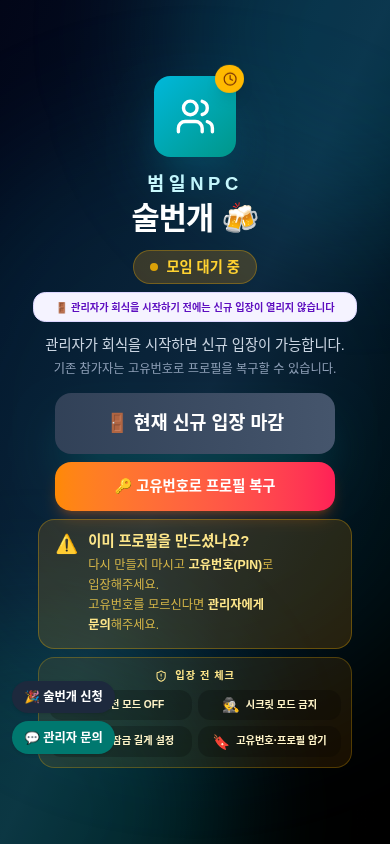 | 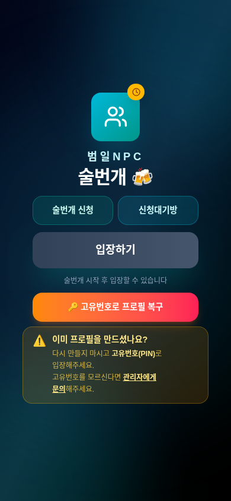 |
| 신청 | 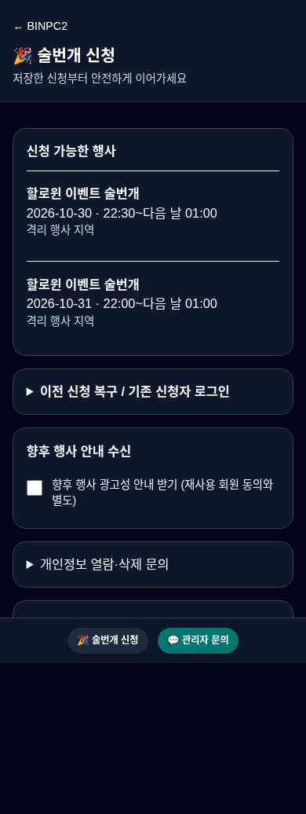 | 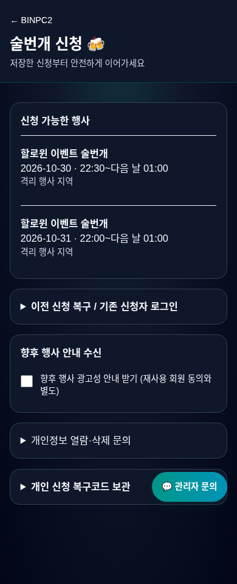 |
| 통합 관리자 | 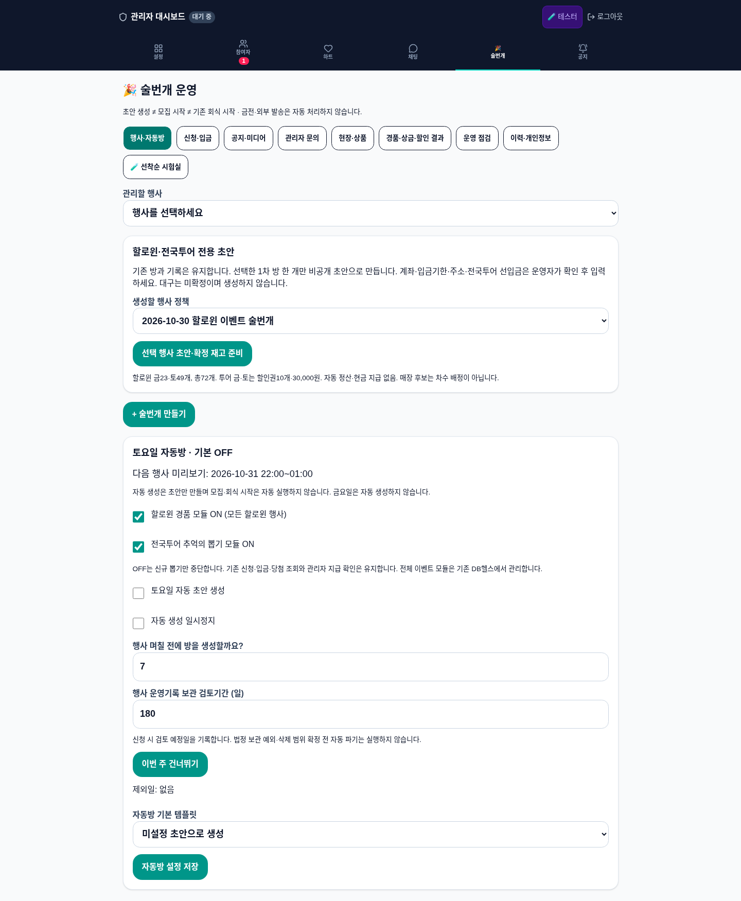 | 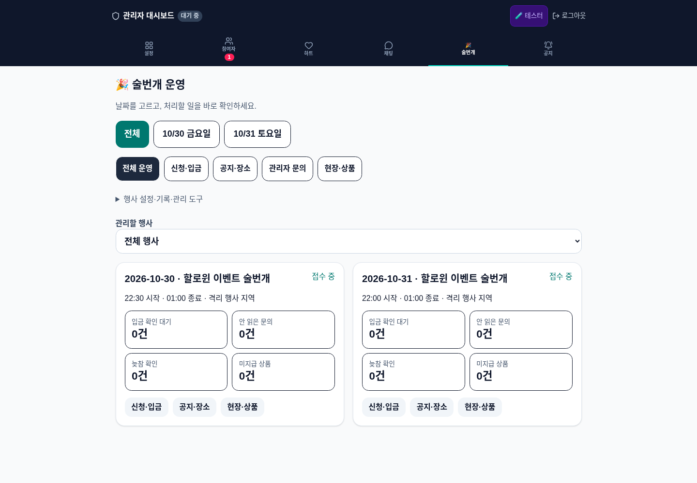 |
| 공지·지도 사진 | 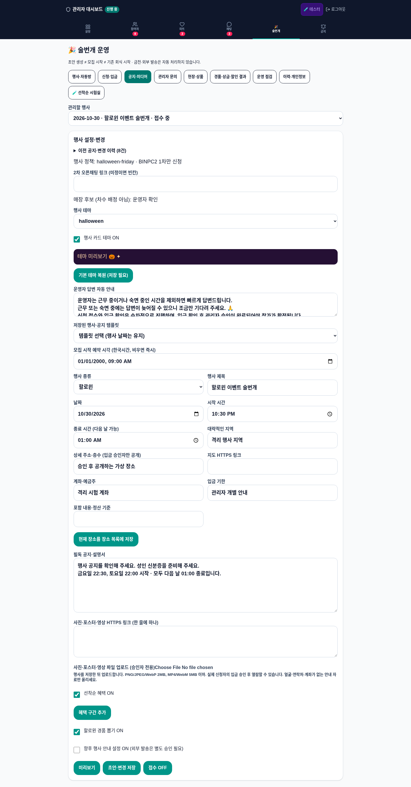 | 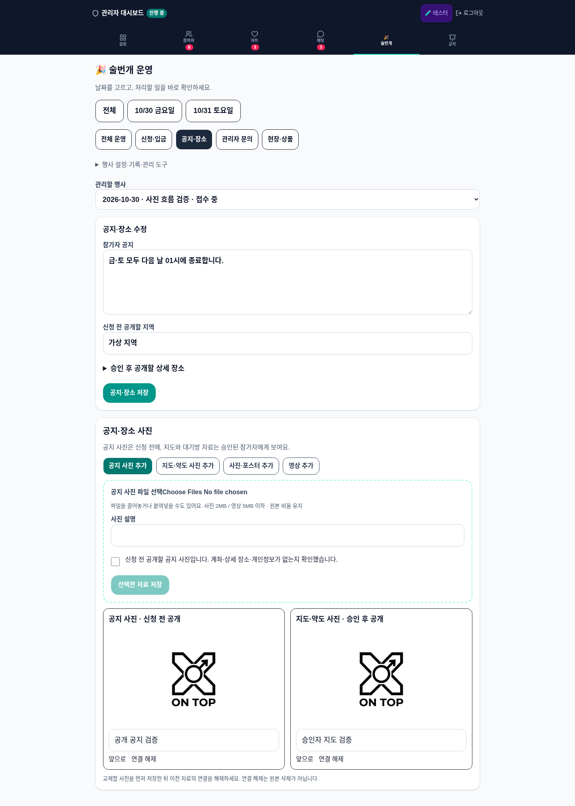 |
| 금·토 상품 | 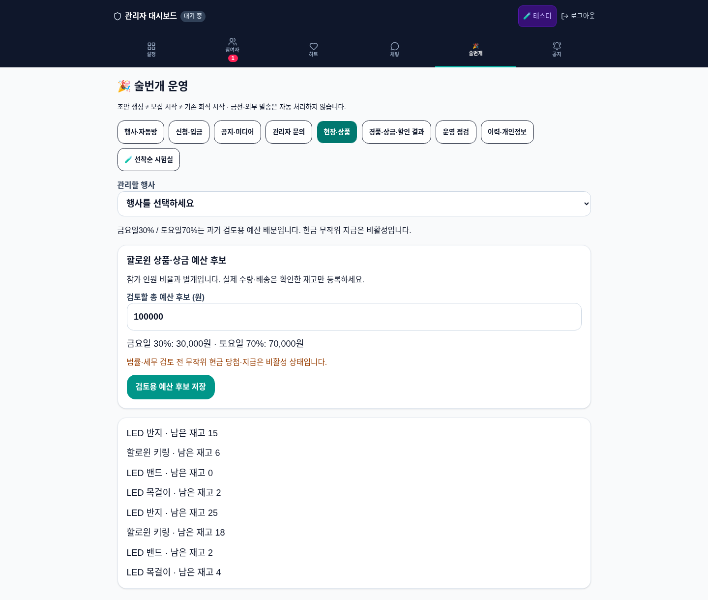 | 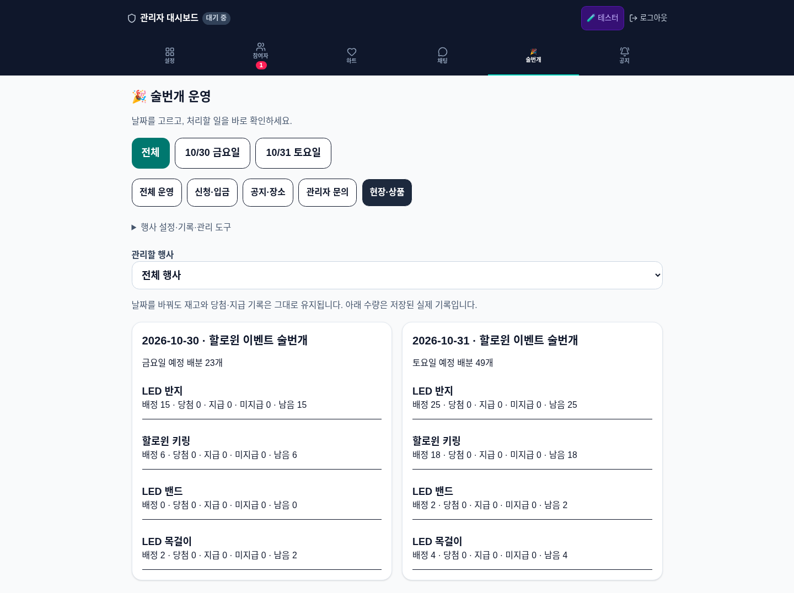 |

| 실제 시작 전 | 서버 시작 후 |
|---|---|
|  | 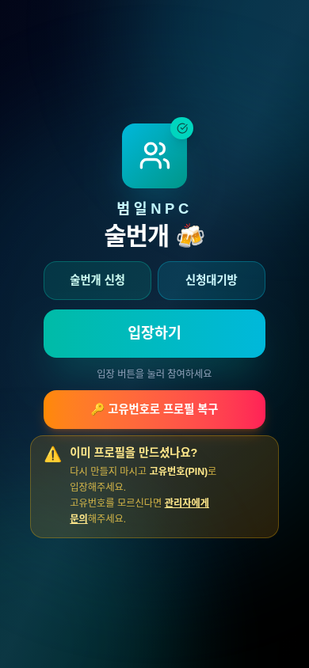 |

짧은 실제 앱 조작 녹화(운영이 아닌 합성 내부 검사):

- [메인 시작 전후·오른쪽 문의·뒤로가기](videos/main-and-inquiry.mp4)
- [통합 관리자·금요일/토요일 상품 전환](videos/admin-and-both-days.mp4)
- [공지/지도 파일·저장·승인 후 표시](videos/photos-and-approval.mp4)
- [새 행사 업로드 실패·같은 행사 재시도](videos/new-event-upload-retry.mp4)

[입금 승인](screenshots/01-actual-admin-payment-approved.png) · [승인자 지도·대기방](screenshots/v4-approved-map-waiting.png) · [사진 다시열기](screenshots/v4-photos-reopened.png) · [문의 초안 다시열기](screenshots/v4-inquiry-draft-reopen.png) · [제공 로고8종](screenshots/v3-eight-logos-actual-admin.png)

이 자료와 ZIP은 설명/검사 자료이며 실행 가능한 독립 HTML 체험판이 아니다. 실제 앱의 기존 주소 반영은 별도 승인 후 진행한다.

최신 소스 `abfa0069` 원격 CI27단계 성공. [실제 실행](https://github.com/aoaldhkd-spec/BINPC2/actions/runs/40646701349). 이전 실패와 이후 재검사를 함께 보존했다. ZIP은 현재 소스/보고서/녹화이며 운영 DB·비공개 키·node_modules·과거 압축 Git 이력은 포함하지 않는다.
