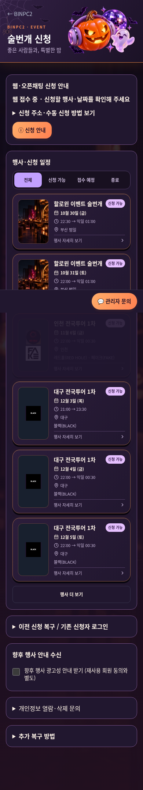
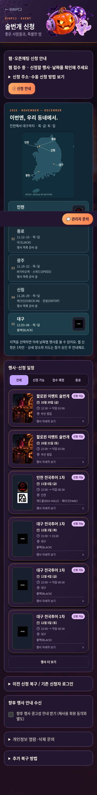
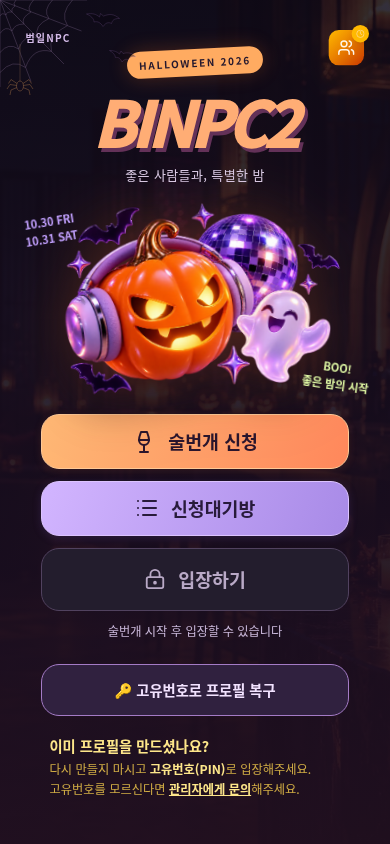
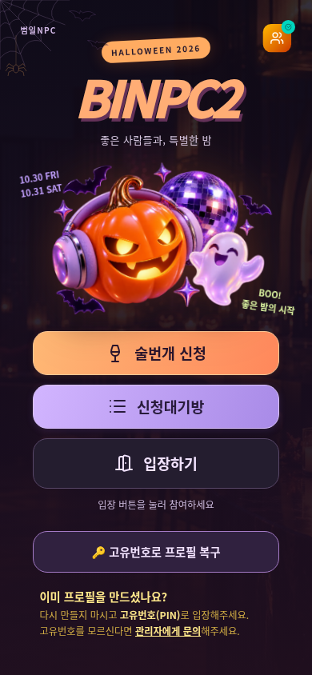

# 실제 앱 화면 검토

전부 **격리 React·Express·PostgreSQL의 합성 시험 자료**다. 운영 사이트 배포 화면이 아니다. 스크린샷에서 ‘테스트OFF/모집 오픈 확인됨’은 실제 신청 경로를 검사하기 위해 명시적으로 연 내부 fixture이며, 운영 모집을 열었다는 뜻이 아니다. 시험 종료 후 내부 앱은 테스트ON·일반 모집 차단으로 돌려둔다.

## 이번 전국투어 화면 전후

| 변경 전(390px) | 변경 후(390px) |
|---|---|
|  |  |

[태블릿](screens/v12-korea-tour-map-768.png) · [PC](screens/v12-korea-tour-map-1440.png) · [320px 상세](screens/v12-daegu-320.png) · [대구 관리자 날짜 선택](screens/v12-daegu-admin-date-selector.png)

## 문의·로고·공지와 지도

- [관리자 새 문의 알림/바로가기/대화](screens/v12-admin-new-inquiry-chat.png) · [참가자 1:1 채팅](screens/actual-inquiry-drawer.png)
- [로고 업로드/이전 원본 복원](screens/admin-logo-original-restore.png) · [지정한 공개 로고의 상세 화면](screens/public-selected-logo-detail.png)
- [1번 용도: 공개 공지 사진 미리보기](screens/v4-notice-preview.png) · [2번 용도: 승인 후 지도](screens/v4-approved-map-waiting.png). 검사 이미지는 가상 파일이며 운영 지도 원본을 공개한 것이 아니다.
- [지도 기반 전국투어 포스터](../campaign-20261029-v12/posters/Tour.png) · [할로윈+전국투어](../campaign-20261029-v12/posters/Combined.png). 검토용으로만 저장했고 게시하지 않았다.

[관리자 화면에서 최종 CI 결과 확인](screens/admin-final-ci-evidence.png) · [API가 현재/과거 코드를 구분한 실제 응답 요약](admin-verification-actual.json). 성공 버튼을 눌러 만든 결과가 아니라 GitHub 실행 이력을 가져온 것이다.

## 기존 기능 보존

| 실제 시작 전 | 실제 시작 후 |
|---|---|
|  |  |

[통합 관리자](screens/v4-admin-overview.png) · [금토 상품](screens/v4-both-day-products.png) · [관리자 입금 승인](screens/01-actual-admin-payment-approved.png) · [프로필 미완료 입장 차단](screens/02-actual-incomplete-entry-blocked.png) · [프로필 완료 대기방](screens/02-approved-complete-waiting-room.png)

[저장 실패 입력 보존](screens/01-save-failure-input-retained.png) · [같은 신청 로그인 복구](screens/v12-password-restored-same-application.png) · [API 오류에서 현장 프로필 보존](screens/mobile-profile-resume-api-unavailable.png) · [승인 취소 시 기록 보존](screens/v12-revoked-session-records-preserved.png)

[17시 직전 테마](screens/halloween-before-1700.png) · [17시 후 자동 복원](screens/halloween-at-1700-restored.png) · [이미지 누락/글자확대/키보드 검사](screens/v12-accessible-events-320-textzoom.png) · [가상3등 시험실](screens/03-halloween-friday.png) · [테스트OFF 후에도 모집 차단](screens/09-test-off-admission-still-closed.png)

화면 파일의 SHA-256/크기/환경은 [screens.json](screens.json)에 있다. 기존 보고서·실패 화면은 삭제하지 않았다. 실물 갤럭시·아이폰의 키보드/잠금 복귀/푸시는 UNKNOWN이다.
